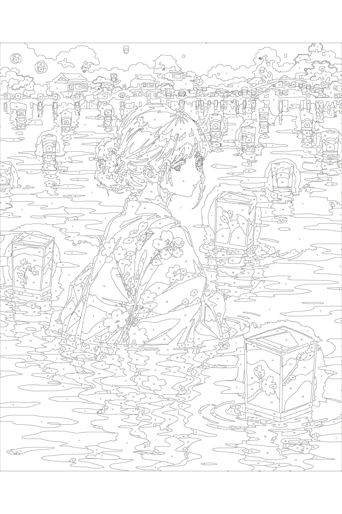

# Раскраска по номерам — 19 красок

## Актуальная художественная версия — 1501 область

**[Открыть чёрно-белую разлиновку](review/lineart_preview.png)** · [Векторный SVG](review/lineart_review.svg) · [Цветная версия (19 красок)](review/color_segmentation_review.png) · [Аудит](review/audit.json)

### Увеличенные сравнения с оригиналом

- [Горизонт: небо, лес, здания, огни и фонарики](review/comparison_horizon.png)
- [Глаза и заколка](review/comparison_face_hairpin.png)
- [Кимоно: ветки, цветы и складки](review/comparison_kimono_sakura.png)
- [Ближний фонарь, корпус, волны и отражение](review/comparison_foreground_lantern.png)

В каждом сравнении: исходный PNG, сегментация в исходной палитре и новая Ч/Б схема. Никакой генерации новой иллюстрации.

### Проверка качества

- **1501 область** (цель — около 1500), 19 исходных цветов.
- **0 пикселей без назначения цвета**: все цвета доступны в [таблице ID области → номер краски](review/region_color_numbers.csv) и [16-битной карте областей](review/region_ids_16bit.png).
- **806 областей** с напечатанным внутри номером 5,3 pt.
- **695 слишком узких областей** имеют цифровую цветовую привязку, но пока **не имеют видимого номера на Ч/Б листе**. Их требуется художественно объединить либо вынести обозначения на отдельный увеличенный лист, не уменьшая 5,3 pt.
- Толщина векторных границ — **0,2 мм**. Контуры теперь упрощаются как общие границы (без двойных линий).
- Сохранены исходные композиция и пиксели оригинала; сокращение микропятен затрагивает только производную сегментацию. На неё нужно смотреть как на **проект для согласования**, не как на готовый к печати PDF.

Построение чёрно-белой разлиновки строго из загруженной картинки. Генерация нового изображения ИИ не используется.

**Исходник:** THE_CASE_ночные_фонари_19_красок.png (1122 × 1402, ровно 19 красок).

## Параметры

- Лист 400 × 600 мм.
- Ширина линий SVG: 0,2 мм.
- Номера SVG: 5,3 pt, без уменьшения.
- Не более 19 цветов; белый в палитре не учитывается.
- Палитра отсортирована по оттенкам.
- Пропорции исходника неизменны: из-за отличающегося соотношения сторон сверху и снизу листа будут белые поля.

## Получить разлиновку

1. Открой вкладку **Actions**.
2. Выбери **Build paint-by-numbers review**.
3. Нажми **Run workflow** и ещё раз **Run workflow**.
4. После завершения открой запуск и скачай архив **detailed-numbered-outline-review**.

Архив содержит: lineart_review.svg — векторная схема; lineart_preview.png — просмотр Ч/Б; color_segmentation_review.png — контрольный цветной вариант после удаления микропятен; palette.csv — номера и цвета; audit.json — отчёт по областям.

**ВАЖНО:** Это проверочный вариант, не финальная печатная раскраска. Исходник никогда не заменяется. Автоматическая чистка удаляет микропятна только в производной сегментации; перед утверждением нужно сравнить её с исходником. Области, куда номер 5,3 pt не помещается, не получают уменьшенного номера, а фиксируются в отчёте audit.json для ручной художественной корректировки. Финальный PDF выпускается после утверждения схемы.

## Локальный запуск

    pip install -r requirements.txt
    python scripts/build.py --input 'THE_CASE_ночные_фонари_19_красок.png' --out outputs
