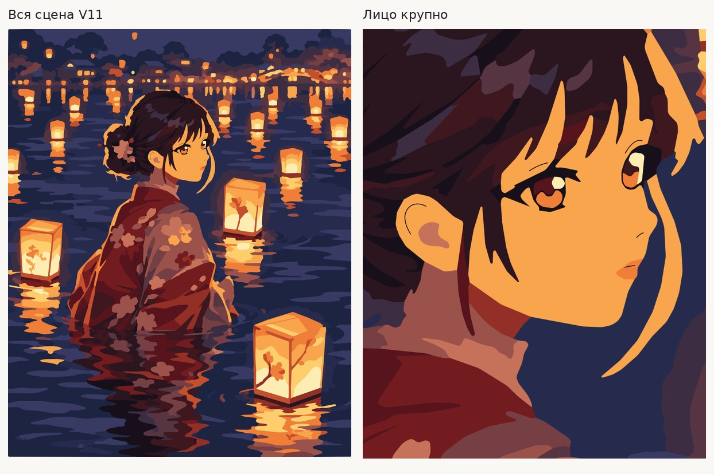

# Ночные фонари · V11



- [Чёрно-белая схема, SVG](output/numbered-outline.svg)
- [Цветной образец, SVG](output/color-map.svg)
- [Палитра из 19 красок, CSV](output/palette.csv)
- [Проверка печатного результата](output/audit.json)

Сцена собрана по [V9](../face_v9_color_only/portrait_v9_smooth_preview.png). В полном рисунке V11 лицо перенесено с [согласованного крупного плана V10](https://github.com/alinavasileva-cco/paint-by-numbers-19/tree/3db8b5b23149287831b5ba8fe9f3624fe24a9b5b/face_reference_v10). Участок под дальним глазом закрашен цветом лица №17. Карта красок за пределами лица и стыков с прядями и шеей совпадает с предыдущей V11.

[Карта областей лица](approved_face_regions.png) получена по контурам V10. [Код переноса](face_transfer.py) совмещает её с полной сценой и подгоняет мелкие области глаз под читаемую нумерацию. Цветной образец и схема используют общие кривые и цвета из одной палитры.

Все 833 поля пронумерованы. На листе 400 × 600 мм при печати в масштабе 100% толщина линии составляет 0,2 мм, размер цифр составляет 5,3 pt. Белая бумага остаётся за пределами палитры.

## Сборка

Нужны Python 3.11 или новее, Inkscape и шрифт Liberation Sans. Из корня репозитория запусти:

```sh
python -m pip install -r night_lanterns_v11/requirements.txt
python night_lanterns_v11/build.py ./v11-print
python night_lanterns_v11/validate.py ./v11-print
```

`bw-numbered.pdf` содержит схему, `color-map.pdf` — цветной образец, `palette.pdf` — палитру по оттенкам. В `print-plates.pdf` собраны оба листа. Проверка сверяет поля, цифры, контуры и палитру в печатном экспорте.
